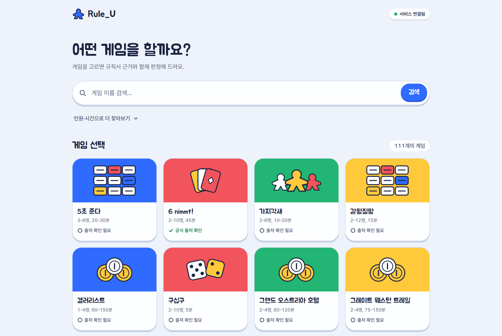
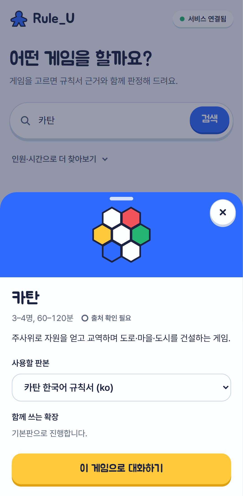
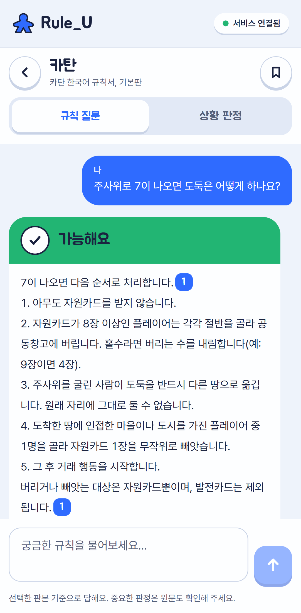
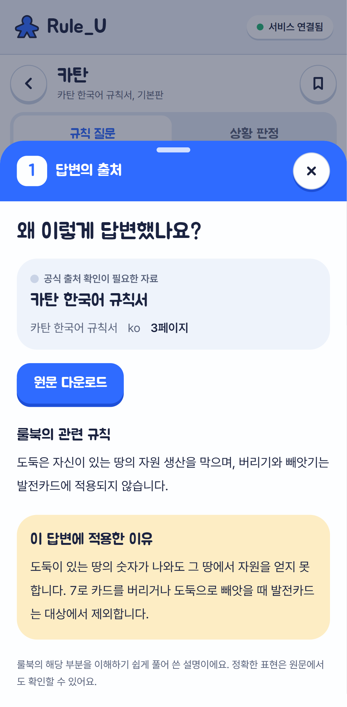

# Rule_U

보드게임을 하다 규칙 때문에 멈췄을 때, 게임과 판본을 고르고 물어보면 **규칙서 근거와 함께** 답해 주는 규칙 도우미입니다. 답변의 출처 번호를 누르면 룰북 몇 쪽의 어떤 규칙을 왜 적용했는지 확인할 수 있습니다.

<p align="center">
  
</p>

<p align="center">
  
  
  
</p>

<p align="center"><sub>게임 선택 → 판본·확장 선택 → 근거와 함께 받은 답변 → 출처 설명</sub></p>

## 주요 기능

- **게임 찾기**: 게임 이름이나 "4명이 함께 할 전략 게임" 같은 자연어로 검색하고, 인원·시간·장르로 거릅니다. 규칙 근거가 준비된 판본만 고를 수 있습니다.
- **규칙 질문 / 상황 판정**: 일반 규칙 질문과 "지금 이 행동이 가능한가" 판정을 나눠 묻습니다. 판정은 *가능해요 · 할 수 없어요 · 조건을 확인해 주세요* 등으로 답하고, 정보가 부족하면 되묻습니다.
- **근거 인용**: 답변 속 `[1]` 번호와 출처 칩을 누르면 해당 룰북 페이지, 쉽게 풀어 쓴 규칙, 이 답변에 적용한 이유를 보여 줍니다. 근거가 부족하면 답을 지어내지 않고 유보합니다.
- **BGG 보조 근거**: 룰북 근거가 부족하면 BoardGameGeek Rules 포럼을 추가로 찾아보고, 공식 룰북과 구분해 표시합니다.
- **대화 편의**: 질문 예시를 누르면 바로 질문하고, 답변을 쓰는 동안 초안을 실시간으로 보여 줍니다. 상황 메모(카드·단계·행동)는 대화에 저장되어 이후 질문에도 쓰입니다.
- **피드백과 저장**: 답변마다 *도움됐어요 / 규칙이 달라요*로 평가하고, 자주 보는 규칙은 저장해 두었다가 다시 볼 수 있습니다.
- **대화 복원**: 익명 세션 쿠키로 게임·판본·확장 조합별 대화를 기억해, 새로고침하거나 게임을 바꿔도 이어서 볼 수 있습니다.

## 기술 스택

| 영역 | 사용 기술 |
| --- | --- |
| 웹 | Next.js(App Router), TypeScript, Tailwind CSS, Zustand, Motion |
| API | FastAPI, SQLAlchemy, Alembic, SQLite |
| 검색 | ChromaDB 벡터 검색 + BM25 하이브리드(RRF) |
| 모델 | OpenAI 호환 채팅·임베딩 API (기본 설정은 SSAFY GMS) |
| 검증 | pytest, ruff, Playwright(E2E), GitHub Actions |

Windows에서 Docker 없이 실행합니다.

## 빠르게 시작하기

준비물: Node.js 20.9 이상(Corepack 포함), Python 3.12~3.14, [uv](https://docs.astral.sh/uv/). pnpm은 따로 설치하지 않고 `corepack pnpm`으로 실행합니다. 아래 명령은 모두 저장소 루트에서 시작합니다(PowerShell).

```powershell
Copy-Item .env.example .env
corepack pnpm install --frozen-lockfile
Set-Location apps/api
uv sync --frozen
uv run alembic upgrade head
uv run python -m rule_u.cli seed-demo   # 화면 확인용 가상 게임 1개
Set-Location ../..
```

터미널 두 개에서 API와 웹을 띄웁니다.

```powershell
# 터미널 1
Set-Location apps/api
uv run uvicorn rule_u.main:create_app --factory --host 127.0.0.1 --port 8000

# 터미널 2 (저장소 루트)
corepack pnpm dev:web
```

- 웹: http://127.0.0.1:3000
- API 문서: http://127.0.0.1:8000/docs
- 상태 확인: http://127.0.0.1:8000/api/v1/health

`.env` 기본값은 외부 API를 부르지 않는 `mock` 모드라 키 없이도 실행됩니다. 실제 답변을 받으려면 [모델 연결](#모델-연결)을 설정하고 [규칙 데이터](#규칙-데이터-적재와-색인)를 적재하세요.

> API는 **단일 프로세스**로 실행합니다(worker를 여러 개 지정하지 않음). 시작할 때 이전 실행에서 끝나지 않은 요청을 실패로 정리합니다. 코드를 업데이트한 뒤에는 `apps/api`에서 `uv run alembic upgrade head`를 실행하고 API 서버를 재시작하세요.

### 화면만 개발할 때 (목 데이터)

API와 Python 없이 프론트엔드만 띄웁니다.

```powershell
corepack pnpm dev:mock
```

모든 `/api/v1` 호출을 브라우저 안의 목 API([apps/web/src/lib/mock](apps/web/src/lib/mock))가 처리하고, 헤더에 `목 데이터` 표시가 나타납니다.

- 질문에 `도둑`(가능+인용), `교역`(조건부), `건설`(불가), `카드`(되묻기), `실패`(생성 실패), `BGG`(추가 검색 단계)가 들어가면 해당 시나리오로 답하고, 그 밖에는 근거 부족으로 답합니다. 시나리오는 [data.ts](apps/web/src/lib/mock/data.ts), 지연 시간은 [handlers.ts](apps/web/src/lib/mock/handlers.ts) 상단에서 바꿉니다.
- 목 대화는 localStorage의 `rule-u-mock-db`에 저장됩니다. 지우면 초기화됩니다.
- 새 API 호출은 [api.ts](apps/web/src/lib/api.ts)의 `api()`를 거쳐야 목 전환이 적용됩니다.

## 설정

모든 설정은 저장소 루트의 `.env`에 둡니다. 항목별 설명은 [.env.example](.env.example)에 있습니다. `.env`와 `data/`는 Git에 올리지 않습니다.

| 변수 | 기본값 | 설명 |
| --- | --- | --- |
| `DATA_DIR` | `data` | DB·원문·색인 폴더. 상대 경로는 저장소 루트 기준 |
| `CHAT_PROVIDER` | `mock` | `compatible`이면 실제 채팅 API 호출 |
| `EMBEDDING_PROVIDER` | `mock` | `compatible`이면 실제 임베딩 API 호출 |
| `SEARCH_MODE` | `hybrid` | `hybrid`(BM25+벡터), `similarity`(벡터만), `mmr`(비교용) |
| `CHAT_STREAM` | `true` | 답변 초안 실시간 표시 |
| `BGG_ENABLED` / `BGG_API_TOKEN` | `true` / 없음 | BGG Rules 포럼 보조 검색 |

### 모델 연결

```dotenv
CHAT_PROVIDER=compatible
CHAT_API_KEY=발급받은_키          # GMS_KEY로 대신 줄 수도 있음

EMBEDDING_PROVIDER=compatible
EMBEDDING_BASE_URL=https://gms.ssafy.io/gmsapi/api.openai.com/v1/
EMBEDDING_MODEL=text-embedding-3-large
EMBEDDING_API_KEY=발급받은_키
EMBEDDING_DIMENSIONS=3072
```

- 채팅 기본 모델은 GMS의 `gpt-5.4-nano`입니다. `CHAT_API_KEY`가 있으면 `GMS_KEY`보다 우선합니다.
- 임베딩 모델이나 차원을 바꾸면 색인을 다시 만들어야 합니다.
- 연결 확인: `apps/api`에서 `uv run python -m rule_u.cli probe --live`. 두 연결이 모두 실제로 확인되지 않으면 종료 코드 1을 돌려줍니다. 키와 응답 본문은 출력하지 않습니다.

### BGG 보조 검색

[BGG 앱 등록](https://boardgamegeek.com/applications)으로 승인받은 토큰을 `BGG_API_TOKEN`에 넣고 API 서버를 재시작합니다. 토큰은 서버 전용이므로 `NEXT_PUBLIC_` 변수로 노출하지 마세요. mock 모드에서는 호출하지 않습니다. 동작과 한계는 [BGG 보고서](reports/bgg-fallback.md)를 참고하세요.

## 규칙 데이터 적재와 색인

`apps/api`에서 실행합니다. 게임 메타데이터와 다운로드된 규칙서 묶음(`Core2/data`)을 읽어 원문 보존 → 텍스트 추출·청크 분할 → 임베딩 색인 순으로 처리합니다. 입력 원문과 JSON은 바꾸지 않습니다.

```powershell
uv run python -m rule_u.cli import-metadata --catalog ../../../data/games
uv run python -m rule_u.cli ingest --catalog ../../../data/games --bundle-root ../../..
uv run python -m rule_u.cli index  --catalog ../../../data/games --continue-on-error
uv run python -m rule_u.cli data-status
```

- `--games catan codenames ...`로 일부 게임만 처리할 수 있습니다. `index --mock`은 외부 호출 없는 구조 검증용입니다.
- 실제 색인은 메타데이터와 규칙서 청크를 설정된 임베딩 제공업체로 보냅니다. 같은 내용은 해시로 알아보고 다시 임베딩하지 않습니다.
- 추출에 실패하거나 누락된 문서가 있는 게임은 규칙 색인을 보류합니다. 추출·색인만으로 판본이 "지원"이 되지는 않으며, 지원 여부는 검색 품질 감사(`python -m rule_u.stage5 audit ... --apply`)로 정합니다.
- 공식 FAQ·정오표는 [config/document-relations.json](config/document-relations.json)에 검증된 관계를 적은 경우에만 검색에 포함됩니다.
- 결과는 `data/manifests/`(게임별 추출 결과), `data/index-reports/`(색인 결과)에 남습니다.

입력 형식과 옵션, 이미지 PDF 복구 과정, 단계별 검증 결과는 [개발기록](docs/개발기록.md)과 [reports/](reports) 아래 보고서에 정리되어 있습니다.

## 검증

```powershell
Set-Location apps/api
uv run pytest -q
uv run ruff check rule_u tests migrations
uv run alembic check
Set-Location ../..
corepack pnpm check:api      # openapi.json·프론트 타입 동기화 확인
corepack pnpm lint
corepack pnpm format:check
corepack pnpm typecheck
corepack pnpm test:e2e
```

- API 스키마를 바꿨다면 `corepack pnpm sync:api`로 `openapi.json`과 프론트 타입(`api.generated.ts`)을 함께 갱신해 커밋합니다.
- E2E는 8100·3100 포트에 임시 DB와 웹 서버를 띄워 데스크톱·모바일 크기에서 실행합니다(실제 `data/app.db`는 쓰지 않음). 로컬은 설치된 Microsoft Edge, CI는 Playwright Chromium을 씁니다. 캡처는 `test-results/`에 생깁니다.
- [GitHub Actions](.github/workflows/ci.yml)가 push·PR마다 API 검사, 웹 검사, E2E를 실행합니다.

### 운영 도구

- 잘못된 답변 신고 내보내기: `uv run python -m rule_u.feedback export --output ../../data/feedback-review.json`
- 답변 유보 원인: `GET /api/v1/requests/{id}`의 `diagnostic` (`no_evidence`, `model_insufficient`, `citation_mismatch`, `bgg_skipped` 등)
- 평가 스크립트: [apps/api/tools](apps/api/tools) (검색어 재작성 비교, 답변 안정성 등)

## 폴더 구조

```text
Rule_U/
  apps/web/            Next.js 화면 · /api/v1 프록시 · 생성된 API 타입
  apps/api/rule_u/     API · 모델/임베딩 연결 · 검색·RAG · CLI
  apps/api/migrations/ Alembic 스키마
  apps/api/tests/      API 테스트
  apps/api/tools/      평가·검토 스크립트
  tests/e2e/           Playwright 브라우저 테스트
  config/              출처 검토·문서 관계 설정
  evals/               검색·답변 평가 질문
  docs/                개발계획 · 개발기록 · 기능명세서 · 화면 캡처
  reports/             단계별 결과 보고서
  data/                로컬 DB · 원문 · 추출문 · 색인 (Git 제외)
```

## 문서

- [기능명세서](docs/기능명세서.md) · [개발계획](docs/개발계획.md) · [개발기록](docs/개발기록.md)
- [디자인 원칙](apps/web/DESIGN.md)
- 결과 보고서: [데이터 적재(2단계)](reports/stage2-completion.md) · [화면(4단계)](reports/stage4-progress.md) · [검색 방식 비교(5단계)](reports/stage5-search-comparison.md) · [검색 후속 평가](reports/search-quality-followup.md)
