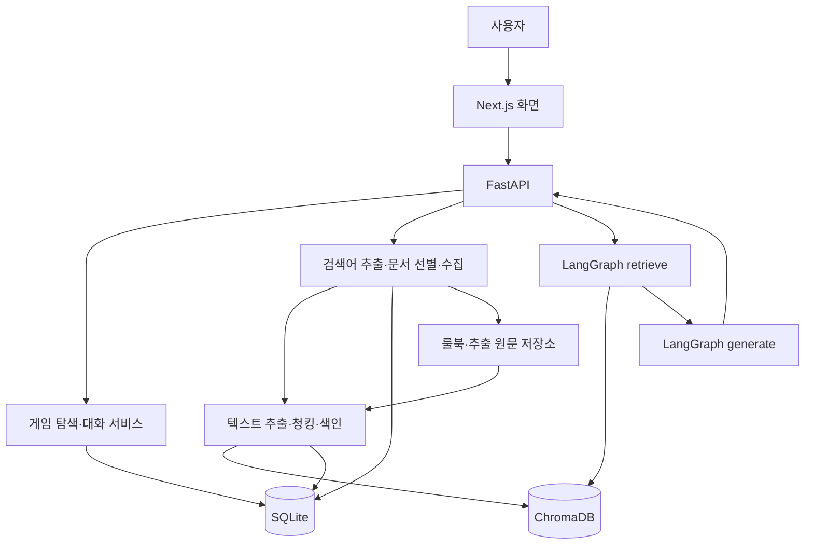

# Rule_U 기능명세서

- 서비스명: Rule_U
- 서비스 설명: 보드게임 규칙 탐색 및 상황별 룰 판정 서비스

- 문서 버전: 1.2 (SQLite·로컬 개발 기준 반영)
- 작성일: 2026-10-21
- 수정일: 2026-10-22
- 관련 문서: [개발계획](./개발계획.md) — 구성·범위·완료 기준 변경 시 함께 갱신한다.
- 기술 구성: Next.js / TypeScript + Python / FastAPI + SQLite + 로컬 ChromaDB
- 기준 문서: RAG 기반 도메인 지식 서비스 요구사항 정의서 (23쪽)
- 목적: 기존 과제 요구사항을 보드게임 도메인에 적용하고 구현·검증 기준을 정의한다.
- 상태: 단계 1 완료. 기반 구조·저장·대체 응답을 구현하고 `gpt-6.1-sol` 채팅과 `text-embedding-3-large` 임베딩(3,072차원)의 실제 통신을 검증했다. 진행 기록은 개발계획에서 관리한다. 검색 설정과 성능 수치는 초기 실험값이며 검증 결과에 따라 조정한다.

## 1. 서비스 개요

사용자가 보드게임과 적용 판본·확장을 선택한 후 규칙을 질문하면, 해당 게임의 메타데이터와 공식 규칙 문서에서 근거를 검색하여 답변한다. 상황 정보가 부족하면 추가 질문을 하고, 문서에 답이 없으면 확인 불가를 안내한다. 주요 주장에 근거 번호를 부여하고 실제 인용한 문서의 제목·출처·페이지를 제공한다.

### 1.1 핵심 사용자 흐름

1. 게임을 검색하거나 자연어 조건으로 탐색한다.
2. 게임과 지원 판본, 적용 확장을 선택한다.
3. 일반 규칙 질문 또는 상황별 룰 판정을 요청한다.
4. 서비스가 관련 문서를 수집·검색하고 필요한 경우 상황을 되묻는다.
5. 답변의 판정·이유·예외 조건을 읽고 근거 문서를 확인한다.
6. 같은 대화에서 후속 질문을 하거나 다른 게임의 대화로 이동한다.

### 1.2 범위와 우선순위

| 구분 | 의미 | 범위 |
|---|---|---|
| 필수 | 원본 명세의 의무 구현 | F2001~F2012 및 NF2001~NF2007 |
| P0 | 필수 구현과 함께 반영할 도메인 설계 | 게임 식별, 판본 구분, 페이지 보존, 상황 확인, 인용 검증 |
| P1 | 필수 기능 완료 후 핵심 심화 및 확장 | 하이브리드 검색, MMR 비교, RAG 전후 평가, 공식 FAQ·정오표 결합 |
| P2 | 후속 또는 선택 범위 | 별도 Reranker, OCR, 준비 가이드, 퀴즈, 계정 로그인 등 |

P0~P2는 추가 기능의 우선순위다. 원본 필수 요구사항을 생략하는 기준이 아니다. F2013~F2016, EX02와 공식 FAQ·정오표 결합에 필요한 EX05는 이번 구현에 포함한다. 나머지 추가 기능은 4절의 범위에 따른다. Neon·Chroma Cloud·공개 배포·도메인·클라우드 저장소 설정은 제외한다.

### 1.3 데이터 확보 조건

- 최종 목표는 100개 이상 게임의 메타데이터와 게임별 지원 판본의 공식 규칙 확보·추출·색인·검증이다. 메타데이터 등록만으로 규칙 지원 완료로 집계하지 않는다.
- 각 항목은 이름, 식별자, 검색 가능한 속성과 출처를 가진다.
- 공식 룰북 등 항목에 연결되는 문서의 접근 가능 여부와 이용 조건을 기록한다.
- 초기 개발은 문서가 확보된 3개 게임으로 검증한 후 전체 범위로 확장한다. 이는 최종 항목 수 요구사항을 대체하지 않는다.
- 등록 게임 수, 규칙 문서 확보 게임 수, 색인 완료 게임 수를 각각 집계한다.
- 규칙 문서 미확보·추출 실패 게임은 탐색용 정보만 제공하고 규칙 Q&A 미지원 상태를 표시하며 완료 집계에서 제외한다. 확보 불가능한 게임은 공식 문서를 확보할 수 있는 다른 게임으로 교체하고 생성된 규칙으로 채우지 않는다. 100개 이상 지원 게임 확보 전에는 최종 완료로 처리하지 않는다.
- 초기 데이터 확보 단계에서 출처·이용 조건과 근거가 필요한 질문 3개 이상을 정리한다. 최종적으로 각 지원 게임에 최소 1개의 근거 확인 질문을 두고 핵심 게임에는 예외·정보 부족·근거 없음 질문을 추가한다.

### 1.4 데이터 출처와 수집 전략

게임 기본 정보와 실제 규칙 문서는 별도 경로로 확보한다. 범용 규칙 API가 모든 게임의 정확한 규칙을 제공한다고 가정하지 않고, 공식 문서를 수집하여 서비스의 검색 DB를 구축한다.

| 데이터 | 우선 출처 | 활용 및 제한 |
|---|---|---|
| 게임 메타데이터 | BGG XML API2, 출판사 게임 정보, 출처가 확인된 파일 | 게임 식별·목록·조건 탐색에 사용. 게임 소개를 전체 규칙으로 취급하지 않음 |
| 규칙 본문 | 해당 판본의 출판사 공식 룰북 PDF | 규칙 답변의 기본 근거. 언어·판본·확장·페이지 보존 |
| 예외·보충 설명 | 공식 FAQ·정오표 | 적용 판본과 수정 관계를 확인한 후 결합 |
| 커뮤니티 질문 | 이용 조건이 확인된 질문 자료 | 평가 질문 발굴용. 초기 서비스의 공식 판정 근거로 사용하지 않음 |

- 메타데이터 JSON·CSV 적재를 먼저 지원한다. BGG API는 등록·승인, 접근 가능성과 이용 조건을 확인한 후 수집 어댑터로 연결하고 XML 응답을 정규화한다. 미승인 상태에서는 허용된 파일·출판사 정보로 적재를 진행한다.
- 초기 수집 검증 후보는 카탄, 티켓 투 라이드, 코드네임이다. 공식 자료의 접근 가능성과 이용 조건, 실제 지원 판본을 확인한 뒤 지원 목록에 등록한다.
- 카탄은 공식 규칙 자료실과 FAQ, 티켓 투 라이드는 공식 게임 페이지의 규칙 다운로드, 코드네임은 CGE 공식 룰북을 우선 확인한다. 구체적인 출처 링크는 14절에 기록한다.
- 한국어판 공식 문서를 우선 확보한다. 영문 공식 문서도 허용하되 한국어로 답변하고 원문 언어·판본을 표시한다. 용어 매핑을 관리하며 번역 결과가 한국어판 규칙과 같다고 자동으로 간주하지 않는다.
- 수집 후 표·아이콘·카드 이미지에 있는 규칙이 추출 텍스트에서 누락되었는지 검사한다. 필요한 정보가 확보되지 않은 카드 상호작용은 확인 불가로 처리한다.
- 공개 다운로드 가능 여부와 서비스에서의 저장·인용·재배포 가능 범위를 구분하여 기록한다.

## 2. 시스템 구성



| 구성 요소 | 책임 |
|---|---|
| Next.js | 게임 탐색, 판본 선택, 채팅, 진행 상태, 근거 확인 |
| FastAPI | 입력 검증, API 응답, 대화 관리, 수집·검색·생성 서비스 호출 |
| Python 수집·색인 모듈 | 외부 문서 수집, PDF 추출, 청킹, 중복 방지, 재색인 |
| LangGraph | `retrieve → generate` 두 노드의 답변 파이프라인 |
| ChromaDB | `game_meta`, `rule_docs` 두 컬렉션 관리 |
| SQLite | 게임·판본 정보, 대화, 메시지, 문서 목록, 요청·수집·색인 상태의 기준 데이터 |
| 파일 저장소 | 룰북 PDF와 추출 원문 보존. 로컬 `Rule_U/data/originals/`·`Rule_U/data/extracted/` |

일반 DB는 SQLite를 사용한다. ChromaDB의 `game_meta`, `rule_docs`는 유지하며 이번 구현에서는 pgvector로 통합하지 않는다. 수집·검색·생성 로직은 Python에 모으고 별도 Node.js 백엔드는 추가하지 않는다. Next.js 서버 기능은 필요한 프록시 등에 한정한다. 라이브러리 버전은 원본 명세와 실제 설치 호환성을 확인한 후 고정한다.

### 2.1 저장소별 역할과 기준 데이터

| 저장소 | 저장 내용 | 조회·복구 원칙 |
|---|---|---|
| SQLite | 정규화된 게임 정보, 판본·확장 관계, 문서 출처·경로·버전, 대화, 인용 정보, 작업 상태 | 목록 조회와 정확한 인원·시간 조건 필터링의 기준 |
| ChromaDB | 검색 텍스트, 규칙 청크, 임베딩, 검색 필터용 메타데이터 | SQLite의 기준 데이터와 보존된 원문에서 재구축 가능한 검색용 데이터 |
| 파일 저장소 | 원본 PDF, 추출 텍스트, 페이지별 추출 결과 | 문서 재처리·재색인과 원문 페이지 확인에 사용 |

게임 정보 일부가 SQLite와 ChromaDB에 함께 들어가는 것은 검색을 위한 의도적인 중복이다. 게임 정보 수정은 SQLite에 반영하고 검색 색인 갱신 작업으로 ChromaDB에 전파한다. 룰북 PDF 전체를 SQLite에 바이너리로 넣는 대신 저장소 경로와 문서 정보를 관리한다. SQLite는 `Rule_U/data/app.db`, ChromaDB는 `Rule_U/data/chroma/`에 저장한다. 실데이터·DB 파일·API 키는 Git에서 제외하고 출처 목록·설정 예시·재현용 테스트 자료는 관리한다.

### 2.2 FastAPI와 SQLite 연결

- 애플리케이션의 DB 접근은 FastAPI에서 처리하고, 수집·색인 스크립트는 같은 Python 데이터 접근 모듈을 사용한다. Next.js는 API를 통해 조회·변경한다.
- 데이터 접근은 SQLAlchemy와 SQLite 드라이버를 사용하고, 스키마 변경 이력은 Alembic으로 관리한다.
- 연결 문자열은 서버 환경변수 `DATABASE_URL`로 제공한다. 브라우저 번들이나 `NEXT_PUBLIC_*` 변수에 포함하지 않는다.
- API는 로컬 단일 프로세스로 실행하며 SQLite 쓰기는 짧은 트랜잭션으로 처리한다. 별도 Redis·작업 서버는 도입하지 않는다.
- 외부 문서 수집이나 LLM 응답을 기다리는 동안 DB 트랜잭션을 열린 상태로 유지하지 않는다. 작업 시작·상태 변경·결과 저장 단위로 짧게 처리한다.
- 개발 데이터와 테스트 데이터를 분리한다. 마이그레이션은 대상 DB 파일 경로를 확인하여 명시적으로 실행한다.
- DB 연결 실패 시 저장 성공으로 응답하지 않는다. 생성은 끝났지만 저장에 실패한 경우를 구분하고, 요청 식별자로 중복 저장을 방지한다.
- Windows 로컬에서 Docker 없이 실행한다. 프론트 의존성은 pnpm, 백엔드는 uv로 관리한다. 외부 모델 API와 문서 수집에는 인터넷 연결이 필요하다.
- 모노레포는 `Rule_U/`이며 `apps/web/`에 Next.js, `apps/api/`에 FastAPI·RAG·수집·색인·마이그레이션을 둔다. 문서는 작업 공간 루트 `docs/`에 유지한다.

## 3. 필수 기능 명세

### F2001. 게임 메타데이터 적재

- **입력:** 출처가 기록된 JSON·CSV 또는 허용된 외부 API 데이터.
- **처리:** 게임 ID, 한글명·원제·별칭, 인원, 플레이 시간, 권장 연령, 장르·메커니즘, 설명 등을 정규화한다. 없는 속성은 임의로 생성하지 않는다.
- **출력:** SQLite에 저장된 정규화된 게임 목록과 게임당 하나의 검색 텍스트. 외부 출처 ID는 내부 게임 ID와 별도로 보존한다.
- **추가 설계 P0:** 별칭을 동일한 게임 ID로 연결하고, 규칙 지원 상태를 별도로 관리한다.
- **완료 기준:** 100건 이상 로드되며 샘플 검색 텍스트에 의도한 속성이 포함된다. 출처·이용 조건을 확인할 수 있다.

### F2002. 메타데이터 임베딩 및 색인

- **입력:** F2001의 검색 텍스트.
- **처리:** 게임당 하나의 청크를 `game_meta`에 저장한다. 게임 ID 기반의 고정 식별자로 upsert한다.
- **출력:** 처리 건수, 성공·실패 건수, 현재 색인 청크 수.
- **추가 설계 P0:** 원본 변경 여부와 색인 상태를 기록한다.
- **완료 기준:** 동일 데이터를 두 번 색인해도 건수가 증가하지 않는다. 정상 데이터의 로드 수와 색인 수가 일치한다.

### F2003. 외부 문서 검색어 추출

- **입력:** 게임, 판본·확장, 질문, 필요한 대화 맥락.
- **처리:** 보드게임 규칙 도우미 역할의 프롬프트 1로 검색어를 추출한다. 선택 게임 자체의 규칙 문서를 항상 검색 대상에 포함한다.
- **출력:** 스키마 검증 가능한 검색어 목록.
- **추가 설계 P0:** 게임 별칭과 규칙 용어를 정규화한다.
- **추가 설계 P1:** 후속 질문을 독립적인 검색 질문으로 재작성한다.
- **예외:** 출력 파싱 실패 시 제한된 재시도 후 게임명·원문 질문 기반 검색어를 사용하고 내부 로그를 남긴다.
- **완료 기준:** 검색어 목록이 파싱되며 선택 게임 문서 검색이 누락되지 않는다.

### F2004. 외부 문서 후보 검색·선별·수집

- **입력:** 검색어 목록과 적용 규칙 범위.
- **처리:** 등록된 공식 출처의 문서 목록에 검색어를 적용하여 후보를 검색하고 프롬프트 2로 관련 후보를 선별한 후 본문을 수집한다.
- **필수 규칙:** 선택 게임 자체의 문서는 선별·길이 제외 규칙보다 우선하여 색인한다. 적용 판본이 잘못된 문서를 대신 사용하지 않는다.
- **출력:** 파일 저장소의 원문·추출 본문과 SQLite의 문서 등록 정보. 제목, 원문 URL 또는 파일명·페이지, 출처 유형, 판본, 수집일, 이용 조건을 포함한다.
- **추가 설계 P0:** 공식 문서 목록과 문서별 적용 판본·확장을 관리한다.
- **캐시:** 이미 수집·색인한 검색어는 다시 외부 호출하지 않는다. 게임·판본·출처·검색어를 캐시 범위에 포함하고 원문 캐시와 항목별 색인 상태를 구분한다.
- **예외:** 자체 문서가 없으면 미확보 상태를 안내한다. 외부 호출 제한 시 제공·확보된 문서 묶음을 읽는 대체 경로를 제공한다.
- **완료 기준:** 선택·제외 문서를 구분할 수 있고, 동일 요청 반복 시 외부 재수집이 없다. 게임 자체 문서가 포함된다.

### F2005. 규칙 문서 청킹 및 색인

- **입력:** 수집된 문서 본문과 메타데이터.
- **처리:** 절·문단 경계를 우선 보존하고 설정된 크기·중복 길이로 청킹하여 `rule_docs`에 저장한다.
- **필수 메타데이터:** 게임 ID, 문서 ID, 제목, 출처, 판본, 확장, 출처 유형, 페이지·절 정보.
- **식별자:** `game_id:edition_id:document_id:index_version:chunk_index`를 사용한다. `index_version`은 문서·색인 설정 버전을 구분하며 동일 버전 재실행에는 같은 ID를 사용한다.
- **추가 설계 P0:** PDF 파일 페이지와 인쇄된 페이지 번호를 구분한다. 페이지를 넘는 청크는 시작·끝 페이지를 저장한다.
- **재색인:** 청킹 설정이나 문서 버전이 바뀌면 새 버전을 별도로 준비·검증한 후 활성 버전을 전환한다. 실패한 색인은 검색에 노출하지 않고 기존 활성 버전을 유지한다. 전환 후 이전 청크는 검색 대상에서 제외하고 정리하며 인용 시점의 문서 정보는 보존한다.
- **완료 기준:** 두 컬렉션이 분리되어 있으며, 설정 변경 시 청크 결과가 달라진다. 같은 문서를 여러 게임에 연결해도 서로 덮어쓰지 않는다.

### F2006. 근거 검색 및 병합

- **입력:** 질문, 게임·판본·확장, 검색 설정.
- **처리:** 선택 게임 메타데이터를 항상 확보하고, 적용 범위 내 외부 문서를 의미 유사도로 검색한다. 결과를 병합하고 동일 청크를 제거한다.
- **설정 정책:** `external_top_k`는 외부 문서 근거 수로 정의한다. 최종 근거는 게임 메타데이터 1건과 외부 문서 최대 k건으로 구성한다.
- **추가 설계 P0:** 게임·판본·확장 필터를 적용한다. 기본판과 선택한 확장의 문서를 함께 허용하되 비선택 확장은 제외한다.
- **추가 설계 P1:** 동일 청크 집합에 키워드·벡터 검색을 적용하고 RRF로 순위를 병합한다. MMR은 별도 비교 모드로 제공하고 기본 유사도 검색을 유지한다. 별도 Reranker는 후속 범위다.
- **완료 기준:** 메타데이터가 누락되지 않고 다른 게임·비지원 판본 문서가 섞이지 않는다. Top-k 변경 결과를 기록한다.

### F2007. 근거 기반 답변 생성

- **입력:** 질문, 필요한 대화 맥락, 번호가 부여된 근거 목록.
- **처리:** LangGraph `retrieve → generate`로 실행한다. 프롬프트 3은 검색 문서만 근거로 사용하고 출처 유형을 구분한다.
- **출력:** 답변, 판정, 적용 조건, 인용 근거 ID, 추가 질문.
- **판정 값:** `allowed`, `not_allowed`, `conditional`, `insufficient_evidence`, `needs_clarification`.
- **추가 설계 P0:** 상황 정보가 부족하면 카드명·현재 단계 등의 확인 질문을 반환한다. 검색 문서가 있어도 질문의 답을 뒷받침하지 못하면 확인 불가로 처리한다.
- **보호 규칙:** 수집 문서에 포함된 명령문은 자료로 취급한다. 사용자·시스템 지시로 실행하지 않는다. 대화 속 이전 답변도 그 자체로 공식 근거가 되지 않는다.
- **완료 기준:** 문서에 없는 질문에 추측하지 않으며, 정보 부족 질문에는 필요한 내용을 되묻는다. 그래프가 두 노드로 구성된다.

### F2008. 답변 근거 표시

- **처리:** 주요 주장에 `[근거 1]` 형식의 번호를 표시한다. 실제 인용한 근거만 화면에 노출한다.
- **표시 항목:** 제목, 출처 유형, URL 또는 파일명·페이지, 적용 판본. 가능한 경우 근거 문장 미리보기를 제공한다.
- **추가 설계 P0:** 인용 ID가 검색 근거 목록에 실제 존재하는지 검사한다. 유효하지 않은 인용이 남은 답변은 그대로 표시하지 않고 제한된 재생성 또는 확인 불가로 처리한다.
- **예외:** 인용이 없으면 “이 답변에 인용된 근거가 없습니다”라고 표시한다.
- **완료 기준:** 답변 인용 번호와 표시된 근거 목록이 일치하며, 미사용 문서는 노출되지 않는다.

### F2009. 게임 선택 및 대화

- **입력:** 게임, 지원 판본, 적용 확장, 질문.
- **처리:** 게임·판본·확장 조합별 대화를 분리한다. 적용 범위를 바꾸면 기존 대화를 보존하고 새 대화를 시작한다.
- **출력:** 선택 범위, 대화 기록, 답변, 근거.
- **추가 설계 P0:** 초기에는 쿠키로 유지하는 익명 세션을 사용하며 세션 식별자로 대화 접근을 제한한다. 대화·메시지·인용 정보를 SQLite에 저장하여 새로고침 후에도 같은 세션에서 대화를 유지한다. 계정·기기 간 동기화는 초기 범위에서 제외한다.
- **완료 기준:** 게임을 전환해도 대화가 섞이지 않으며 이전 게임으로 돌아오면 기록을 확인할 수 있다.

### F2010. 상황별 룰 판정

- **입력:** 하려는 행동, 현재 단계, 관련 카드·구성물, 추가 상황. 질문에 필요한 정보만 요청한다.
- **처리:** F2006~F2008의 검색·생성·인용 흐름을 재사용한다.
- **출력:** 가능 여부, 적용 규칙, 예외 조건, 근거, 필요한 확인 질문.
- **화면:** 일반 Q&A와 구분되는 상황 판정 모드를 제공한다. 자유 입력을 허용하고 정보가 부족할 때만 보완한다.
- **완료 기준:** 단순 설명을 넘어 구체적인 상황을 판정하며, 판정의 근거를 함께 제시한다. 근거가 부족하면 판정을 유보한다.

### F2011. 자연어 조건 기반 게임 탐색

- **입력:** “4명이 30분 안에 할 수 있는 협력 게임”과 같은 조건.
- **처리:** 인원·시간·장르 조건을 구조화한다. ChromaDB의 메타데이터 검색과 SQLite의 구조화된 조건 조회를 조합하고 최종 후보의 조건 충족 여부를 SQLite 기준 데이터로 검증한다.
- **정책:** 엄격한 조건을 검증할 데이터가 없는 게임은 일치 결과에서 제외한다. 결과가 없으면 조건 완화를 제안하되 자동으로 완화하지 않는다.
- **출력:** 조건에 맞는 게임 카드, 일치 이유, 규칙 Q&A 지원 상태.
- **완료 기준:** 조건에 어긋나는 항목이 포함되지 않으며 게임 선택 후 해당 게임의 대화로 이동한다.

### F2012. 진행 상태 및 오류 안내

- **상태:** 문서 확인, 문서 수집, 근거 검색, 답변 생성, 완료, 실패.
- **안내:** 색인 없음, API 키 누락, 검색 결과 없음, 문서 미지원, 외부 API 제한, 타임아웃, 텍스트 추출 실패, SQLite 연결 실패, 대화 저장 실패.
- **추가 설계 P0:** 현재 지원 판본·확장과 규칙 문서 확보 상태를 표시한다.
- **오류 정책:** 사용자에게 원인 범주와 가능한 다음 행동을 안내하고 키·프롬프트 전문·스택 추적은 노출하지 않는다.
- **도메인 정책:** 보드게임 서비스에는 건강·금융 면책 문구를 적용하지 않는다. 하우스룰은 공식 규칙과 구분한다.
- **완료 기준:** 처리 단계와 주요 비정상 상태를 화면에서 재현·확인할 수 있다.

## 4. 심화 및 추가 기능

| ID | 연결 요구사항 | 기능 | 우선순위·범위 | 완료 기준 |
|---|---|---|---|---|
| F2013 | 직접 프론트엔드 | Next.js 채팅·게임 탐색·근거 화면, FastAPI와 API 계약 분리 | 이번 구현 | 질문·답변·근거가 연결되고 화면과 서버가 분리됨 |
| F2014 | MMR | 유사도 검색과 MMR 전환 및 결과 비교 | P1, 이번 구현 | 같은 질문의 근거 목록과 중복 정도 비교 |
| F2015 | 품질 비교 | RAG 미사용·사용 답변 비교 보고서 | P1, 이번 구현 | 최소 5개 질문의 정확성·출처·확인 불가 대응 비교 |
| F2016 | 출처 결합 | PDF 룰북 + 웹 공식 FAQ·정오표 | P1, 이번 구현 | 출처 종류 표시, 수집·청킹 차이와 이유 문서화 |
| EX01 | F2003 | 별칭·게임 용어 사전 | P0 | 별칭과 공식 명칭으로 동일 게임·규칙 탐색 |
| EX02 | F2006 | 키워드 + 벡터 하이브리드 검색 | P1, 이번 구현 | 고유 카드명·상황 질문 평가에서 기본 검색과 비교 |
| EX03 | F2006 | 별도 Reranker를 통한 검색 결과 재정렬 | P2, 후속 | 동일 후보에서 근거 적합도·지연·비용 비교 |
| EX04 | F2005 | 인접 문단·상위 절 추가 검색 | P1 선택 | 예외·조건이 잘린 사례의 답변 개선 확인 |
| EX05 | F2004/F2007 | 정오표 적용 및 문서 충돌 안내 | P1, 이번 구현 | 적용 판본과 수정 관계가 확인될 때만 우선 적용 |
| EX06 | F2001 | BGG 등 외부 게임 데이터 API 연동 | P1, 승인·접근 확인 시 | 출처·이용 조건·인증 확인 후 데이터 정규화 |
| EX07 | F2005 | 이미지 PDF OCR | P2, 후속 | 샘플 페이지의 용어·숫자·표 추출을 원문과 대조 |
| EX08 | F2010 | 첫 플레이 준비 가이드·턴 요약 | P2, 후속 | 각 단계에 규칙 근거 제시 |
| EX09 | F2010 | 규칙 학습 퀴즈 | P2, 후속 | 정답·해설이 확보한 규칙 문서에 근거함 |
| EX10 | F2009 | 답변 평가·오류 신고 | P2 | 질문·답변·근거와 평가 기록 연결 |

MMR은 다양성, 재정렬은 관련성을 개선하려는 방법이다. 적용 자체를 품질 향상으로 간주하지 않고 동일 질문 세트로 확인한다. 후속 범위의 재정렬을 도입할 때도 LangGraph의 retrieve 내부에서 실행해 두 노드 구조를 유지한다.

## 5. 화면 명세

| 화면 | 주요 요소 | 상태·행동 |
|---|---|---|
| 게임 탐색 | 이름 검색, 자연어 조건, 결과 카드 | 로딩·결과 없음·지원 상태, 선택 시 대화로 이동 |
| 게임·규칙 범위 선택 | 판본, 기본판, 확장 목록 | 지원하는 조합만 선택, 변경 시 새 대화 |
| 규칙 Q&A | 메시지 목록, 질문 입력, 처리 상태 | 중복 제출 방지, 실패 시 재시도 |
| 상황 판정 | 상황 입력, 판정, 이유, 예외 | 필요한 추가 정보 질문 |
| 근거 패널 | 번호, 문서명, 유형, 판본, 페이지, 링크 | 실제 인용 근거만 노출, 문서 열기 실패 안내 |

초기 화면은 게임 선택 영역, 대화 영역, 근거 패널로 구성한다. 작은 화면에서는 근거를 접이식 영역으로 제공한다. API 키나 전체 프롬프트를 보여주는 개발용 화면은 사용자 UI에 포함하지 않는다.

## 6. 데이터 설계

### 6.1 주요 엔터티

아래 엔터티는 SQLite에 저장한다. 실제 테이블·제약조건은 Alembic 마이그레이션으로 관리한다.

| 엔터티 | 주요 필드 |
|---|---|
| Game | id, external_source, external_id, name_ko, name_original, aliases, min_players, max_players, min_minutes, max_minutes, categories, description, source, updated_at |
| Edition | id, game_id, label, language, publisher, supported |
| Expansion | id, game_id, compatible_edition_ids, name, supported |
| Document | id, title, source_type, source_url, storage_key, extracted_text_key, language, version, content_hash, license_note, fetched_at |
| DocumentScope | document_id, game_id, edition_id, expansion_id (기본판은 없음) |
| CollectionState | source_id, game_id, edition_id, normalized_query, fetch_status, index_status, content_hash, config_version |
| Conversation | id, session_id, game_id, edition_id, expansion_ids, created_at |
| Message | id, conversation_id, role, content, verdict, cited_source_ids, created_at |
| Citation | id, message_id, document_id 또는 game_id, chunk_id, source_version, title_snapshot, page_start, page_end, excerpt |
| Request | id, conversation_id, client_request_id, status, stage, result_message_id, error_code, created_at, updated_at |

페이지 정보를 포함하는 근거 식별자는 문서 버전과 연결한다. 문서 갱신 이후에도 이전 답변의 출처를 추적할 수 있도록 인용 시점의 제목·페이지·버전을 메시지와 함께 보존한다.

하나의 원문이 여러 게임·판본에 적용될 수 있으므로 Document와 적용 범위인 DocumentScope를 분리한다. 같은 파일은 content_hash로 재사용하되, 항목별 색인은 별도로 유지한다. 외부 출처와 외부 게임 ID 조합, 대화 ID와 client_request_id 조합에는 중복 방지 제약을 둔다. 판본 호환·대화의 선택 확장 같은 다대다 관계는 연결 테이블로 구현한다.

### 6.2 벡터 컬렉션

| 컬렉션 | 색인 단위 | 메타데이터 | 용도 |
|---|---|---|---|
| game_meta | 게임 1건 = 청크 1건 | game_id, 이름, 출처, 인원·시간 등 | 게임 탐색, 선택 게임의 기본 근거 |
| rule_docs | 규칙 문서의 절·청크 | game_id, edition_id, expansion_id, document_id, source_type, title, source, page_start, page_end, section, version | 규칙 검색·판정 |

판본별 차이가 있는 수치는 일반 게임 메타데이터만으로 판정하지 않고 해당 판본 문서에서 확인한다. 벡터 DB의 지원 자료형에 맞게 메타데이터를 정규화하며, 복잡한 관계 정보는 일반 DB에 저장한다.

### 6.3 저장·색인 갱신 흐름

1. 게임 메타데이터를 정규화하여 SQLite에 저장한다.
2. 게임 검색 텍스트를 생성해 `game_meta`에 upsert한다.
3. 공식 룰북·FAQ를 수집하고 원본과 추출 결과를 파일 저장소에 보존한다.
4. SQLite에 문서 정보·적용 범위와 수집 완료 상태를 기록한다.
5. 규칙을 청킹·임베딩하여 `rule_docs`에 저장하고 검증한 후 색인 완료로 표시한다.
6. 질문 처리 시 SQLite에서 적용 범위를 확인하고 ChromaDB에서 근거를 검색한다.
7. 답변과 실제 인용 근거를 SQLite에 저장하고 사용자에게 반환한다.

SQLite와 ChromaDB 사이에 단일 트랜잭션이 있다고 가정하지 않는다. 색인 실패 시 상태를 실패·재시도 가능으로 남기고, 고정 ID와 문서 해시·설정 버전을 이용해 중복 없이 재처리한다. 갱신 중인 문서는 완료된 색인 버전만 검색에 사용하도록 관리한다.

## 7. API 계약 초안

모든 API는 `/api/v1` 아래 제공한다. 아래 경로는 구현 제안이며 OpenAPI 스키마를 기준으로 프론트엔드와 맞춘다.

| Method | 경로 | 주요 입력 | 주요 출력 |
|---|---|---|---|
| GET | /games | query, page, page_size | 게임 목록, 규칙 지원 상태, 페이지 정보 |
| GET | /games/{game_id} | 게임 ID | 게임 상세, 지원 판본·확장 |
| POST | /games/search | query | 구조화된 조건, 검증된 결과, 일치 이유 |
| POST | /conversations | game_id, edition_id, expansion_ids | conversation_id |
| GET | /conversations/{id} | 대화 ID | 선택 범위, 메시지 목록 |
| POST | /conversations/{id}/messages | message, mode, client_request_id | request_id, 처리 상태 |
| GET | /requests/{request_id} | 요청 ID | 현재 단계, 완료 시 답변·근거, 실패 시 오류 |
| GET | /sources/{source_id} | 근거 ID | 제목, 출처, 판본, 페이지, 미리보기 |
| GET | /health | 없음 | 서비스 상태, 민감정보 없는 준비 상태 |

질문 제출 POST는 `202 Accepted`와 요청 ID를 반환하고 프론트엔드는 상태 조회로 진행 상태를 표시한다. 동일 대화의 동일 `client_request_id` 재전송은 기존 요청을 반환하며 다른 요청이 처리 중이면 중복 실행을 막는다. 텍스트 스트리밍은 선택 확장이다. 요청 상태와 결과는 저장하고, 서버 재시작으로 중단된 작업은 실패·재시도 가능 상태로 복구한다. 같은 대화에서는 생성 요청을 한 번에 하나만 처리한다.

### 7.1 질문 요청 예시

```json
{
  "message": "이 카드를 사용한 뒤 추가 행동을 할 수 있나요?",
  "mode": "ruling",
  "client_request_id": "client-generated-uuid"
}
```

### 7.2 추가 정보가 필요한 응답 예시

```json
{
  "request_id": "req_001",
  "status": "completed",
  "result": {
    "verdict": "needs_clarification",
    "answer": "사용한 카드 이름과 현재 턴 단계를 알려주세요.",
    "clarification_questions": ["카드 이름은 무엇인가요?", "현재 어떤 단계인가요?"],
    "citations": [],
    "citation_notice": "이 답변에 인용된 근거가 없습니다."
  }
}
```

완료 응답의 citations는 `id`, `title`, `source_type`, `edition`, `url` 또는 `filename`, `page_start`, `page_end`, `excerpt`를 포함한다. 외부 API 키는 Python 서버에만 저장한다. 익명 세션도 다른 세션의 대화·요청 결과에 접근하지 못하도록 검사한다. Next.js의 `/api/v1` 프록시로 FastAPI에 연결하여 브라우저에서 동일 출처로 호출한다. 로컬 원문은 문서 ID로 조회하며 임의 파일 경로 입력은 허용하지 않는다. OpenAPI 기반 TypeScript 타입을 생성해 프론트와 응답 형식을 맞춘다.

수집·색인 CLI는 메타데이터 적재, 문서 수집, 색인, 상태 확인, 평가 실행을 제공한다.

## 8. 프롬프트와 검색 설정

| 프롬프트 | 입력 | 출력·제약 |
|---|---|---|
| 1: 검색어 추출 | 게임, 판본, 질문, 대화 맥락 | JSON 검색어 목록, 선택 게임 자체 문서 포함 |
| 2: 후보 선별 | 후보 ID, 제목, 요약, 적용 범위 | 선택 후보 ID와 사유, 후보 밖 ID 금지 |
| 3: 답변 생성 | 질문, 근거 목록, 상황 정보 | 답변·판정·인용 ID·확인 질문, 근거 밖 사실 생성 금지 |

프롬프트 2의 선택 이후에도 게임 자체 문서 포함 규칙을 코드에서 보장한다. LLM 출력은 스키마 검증을 통과해야 사용한다.

| 설정 | 초기 제안 | 설명 |
|---|---|---|
| chunk_size | 1000자 | 절 경계를 우선 고려하는 최대 분할 기준 |
| chunk_overlap | 200자 | 문맥 연결용 중복 |
| external_top_k | 5 | 답변에 전달할 외부 문서 청크 수 |
| search_mode | similarity | hybrid·MMR은 비교 후 선택 |
| candidate_k | 20 | 심화 검색·재정렬 후보 수 |
| rerank_enabled | false | 별도 Reranker는 후속 범위로 현재 비활성 |

주요 환경 설정은 DB URL, 데이터 경로, 모델 API 주소·키·모델 ID, 임베딩 모델이다. 임베딩 모델이나 차원이 바뀌면 기존 색인을 섞어 쓰지 않고 재생성한다.

모든 수치는 확정 성능값이 아닌 초기 실험값이다. 설정 변경 전후의 근거 적합도와 답변 결과를 비교하고 선택 이유를 설계문서에 기록한다.

## 9. 비기능 요구사항

| ID | 구현·운영 정책 | 검증 기준 |
|---|---|---|
| NF2001 | 수집·검색·생성 소요 시간을 분리 측정 | 최초 수집과 캐시 사용 질문의 p50·p95 기록. 초기 잠정 목표는 캐시 질문 p95 15초 이내이며 환경 확인 후 조정 |
| NF2002 | 검색어 수집 캐시, 원문 재사용, 항목별 색인 상태 분리 | 같은 질문 반복 시 외부 재수집 없음 |
| NF2003 | 환경변수, 키 없는 설정 예시, 저장소 제외 | 소스·로그·제출물에 비밀값 없음 |
| NF2004 | 내부 로그와 사용자 오류 응답 분리 | 화면·응답에 키·프롬프트 전문·추적 정보 없음 |
| NF2005 | 수집·색인·검색·생성·UI 책임 분리 | 모듈별 책임과 호출 관계 확인 |
| NF2006 | 타임아웃, 제한된 재시도, 호출 간격, 요구되는 식별 정보 | 출처별 정책과 호출 로그 확인 |
| NF2007 | 데이터·문서의 출처와 이용 조건 기록 | 출처 목록과 실제 수집 데이터 대조 |

첫 수집 질문은 별도로 측정하고 진행 상태를 제공한다. 무제한 대기는 허용하지 않으며 전체 요청 제한시간은 로컬 실행·모델 환경을 확인한 후 설정한다. 원문 파일 제공 범위는 이용 조건에 따라 정하고, 원문 재배포가 허용되지 않으면 출처 링크와 허용 범위의 인용을 제공한다.

## 10. 검증 및 수용 기준

| 테스트 ID | 대상 | 시나리오 | 기대 결과 |
|---|---|---|---|
| T01 | F2001~2002/F2005 | 전체 데이터 적재·색인 및 지원 상태 확인 | 100개 이상 게임의 메타데이터·공식 규칙·판본·색인·게임별 근거 검증 기록 확보, 항목 수와 메타데이터 청크 수 일치 |
| T02 | F2002 | 같은 데이터 두 번 색인 | 청크 수 증가 없음 |
| T03 | F2003~2004 | 검색어 추출·후보 선별 | 파싱 가능, 선택·제외 후보 기록, 자체 문서 포함 |
| T04 | F2004/NF2002 | 동일 질문 반복 | 외부 문서 재수집 없음 |
| T05 | F2005 | 청킹 설정 변경 후 재색인 | 새 버전 검증 후 활성 전환, 이전 청크 검색 제외, 실패 시 기존 활성 버전 유지 |
| T06 | F2006 | Top-k 변경, 다른 게임 문서 혼재 상태에서 검색 | 결과 수 정책 준수, 범위 밖 근거 없음 |
| T07 | F2007 | 룰북에 없는 질문 | 추측 없이 확인 불가 |
| T08 | F2007/F2010 | 정보가 부족한 상황 | 필요한 상황을 되묻고 판정 유보 |
| T09 | F2008 | 인용 있는 답변·없는 답변 | 번호 일치, 실제 인용만 표시, 미인용 안내 |
| T10 | F2009 | 게임·판본 전환 후 복귀 | 기록 분리·유지 |
| T11 | F2011 | 인원·시간·장르 조건 탐색 | 조건 충족 후보만 반환, 선택 후 채팅 연결 |
| T12 | F2012 | 키 누락·색인 없음·검색 결과 없음 | 적절한 안내, 내부 정보 비노출 |
| T13 | F2015 | 대표 질문 5개 이상 전후 비교 | 정확성·근거·모름 대응 결과표 |
| T14 | 심화 검색 | 기본 검색·하이브리드·MMR 비교 | 같은 데이터·질문·생성 설정으로 비교 |
| T15 | 접근 제어 | 다른 익명 세션의 대화 조회 | 접근 거부 |
| T16 | F2007 | 규칙 문서에 지시문 포함 | 지시문을 실행하지 않고 자료로 처리 |
| T17 | SQLite 영속 저장 | 대화 생성 후 FastAPI 재시작, 동일 세션으로 조회 | 대화·인용·작업 상태 유지 |
| T18 | 연결·저장 실패 | SQLite 연결 실패와 응답 저장 실패 재현 | 성공으로 오인하지 않는 안내, 비밀값 비노출 |
| T19 | 저장소 일관성 | SQLite 저장 후 ChromaDB 색인 실패·재실행 | 실패 상태 기록, 중복 없이 복구, 완료된 버전만 검색 |
| T20 | 문서 보존 | 원문에서 재추출·재색인 후 출처 확인 | 게임·판본·버전·페이지 추적 가능 |
| T21 | 요청 중복 방지 | 동일 client_request_id로 재전송 | 중복 메시지·중복 작업 생성 없음 |

정확성 평가는 공식 문서와 대조한 기준 답변·근거 페이지를 사용한다. LLM의 자체 평가만으로 통과를 결정하지 않는다. Playwright로 게임 선택 → 질문 → 답변 → 근거 확인 → 게임 전환을 검증하고 pytest로 DB·검색·실패 처리를 검증한다. 자동 테스트의 모델 호출은 대체 응답을 사용하고 실제 모델 평가는 별도 실행한다. 결과는 통과·실패·미확인으로 기록하고 필수 화면 캡처, 셀프·상호 체크리스트를 함께 보관한다.

## 11. 구현 순서

개발계획의 5단계를 동일하게 적용한다. 단계별 체크리스트와 진행 상태는 [개발계획](./개발계획.md)에서 관리한다.

1. **프로젝트 기반·연결 검증:** Next.js·FastAPI 구조, SQLite·SQLAlchemy·Alembic과 로컬 저장 경로를 구성한다. 모델·임베딩 연결부를 분리하고 실제 호출 규격을 확인한다. API 미제공 시 대체 응답으로 개발하되 실제 연결 완료로 표시하지 않는다.
2. **데이터 확보·수집·색인:** 초기 3개 게임의 출처·이용 조건을 확인하고 JSON·CSV 적재, 페이지별 추출, 두 컬렉션 색인, 캐시·중복 방지를 검증한다.
3. **근거 기반 Q&A·상황 판정:** 세 프롬프트·두 노드, 범위 제한 검색, 되묻기·확인 불가, 인용 검증, 대화 저장과 재색인 버전 전환을 구현한다.
4. **사용자 화면·API 연결:** 게임 탐색·조건 검증·판본 선택·채팅·근거 패널, 요청 상태 조회·재시도, 익명 세션과 동일 출처 프록시를 연결한다.
5. **검색 고도화·100개 게임 확장:** 하이브리드·RRF, MMR 비교, 공식 FAQ·정오표 결합, 최소 5개 대표 질문의 RAG 전후 평가를 수행한다. 100개 이상 지원 게임의 원문·판본·색인·게임별 검증 기록과 비교 보고서를 확보한다.

F2001~F2013과 NF2001~NF2007 및 이번 구현에 포함한 심화 기능의 실행 증거를 확보하고 README 절차대로 설치·적재·색인·실행할 수 있어야 한다. 공개 배포 준비는 로컬 버전 검증 이후 별도 계획으로 진행한다.

## 12. 제출물

- 기능별 요구사항 정의서와 도메인 선정 근거.
- RAG 파이프라인 설계문서: 컬렉션, 메타데이터, 청킹, 프롬프트, 검색·중복 제거, 근거 표시, 설정 선택 이유.
- Next.js 및 Python 소스코드, 수집·색인 스크립트.
- SQLite 스키마용 Alembic 마이그레이션과 초기 데이터 적재 절차. 실제 연결 비밀값은 제출하지 않는다.
- 실행 방법, 환경변수 예시, 데이터 준비·색인 절차를 담은 README.
- 출처·이용 조건 목록.
- 요구사항 대조표, 테스트 결과표, 화면 캡처, 셀프·상호 체크리스트.
- 하이브리드 검색·MMR 비교, RAG 전후 평가, 공식 FAQ·정오표 결합의 검증·비교 결과와 100개 이상 지원 게임의 검증 기록.
- 제출 파일명: `Rule_U.zip`.

## 13. 구현 전 확정할 사항

- 실제 지원 게임 목록.
- 메타데이터·룰북·FAQ 출처 및 이용 조건.
- 초기 지원 판본·확장의 범위.
- 사용할 LLM·임베딩 모델의 실제 ID, API 주소·요청 형식·예산과 임베딩 지원 여부·차원. 사용자가 보유한 API 키와 호출 규격으로 검증하며 `5.6 Sol` 표시 이름만으로 추정하지 않는다. 비밀값은 문서나 Git에 저장하지 않는다.
- 로컬 원문·SQLite·ChromaDB의 백업·복구 세부 절차. 저장 위치와 로컬 실행 방식은 2절에 확정했다.
- EX04·EX10 등 선택 기능의 도입 여부. 핵심 심화와 후속 범위는 1.2절·4절의 확정 범위를 따른다.

## 14. 참고 자료

- 원본: RAG 기반 도메인 지식 서비스 요구사항 정의서.
- [FastAPI 문서](https://fastapi.tiangolo.com/)
- [Next.js 문서](https://nextjs.org/docs)
- [BGG XML API2](https://boardgamegeek.com/wiki/page/bgg_xml_api2)
- [BGG API 이용 안내](https://boardgamegeek.com/using_the_xml_api)
- [CATAN 공식 규칙 자료실](https://www.catan.com/understand-catan/game-rules)
- [CATAN 공식 FAQ](https://www.catan.com/faq)
- [Ticket to Ride 공식 게임·규칙 페이지](https://www.daysofwonder.com/game/ticket-to-ride/)
- [CGE 코드네임 공식 영문 규칙 PDF](https://czechgames.com/files/rules/codenames-rules-en.pdf)

외부 API는 선택 후보이며 연결·사용 승인을 받은 것으로 간주하지 않는다. 로컬 ChromaDB의 벡터 검색에 별도 키워드 검색과 RRF 결과 병합을 조합한다. Chroma Cloud 전용 기능은 사용하지 않는다.
