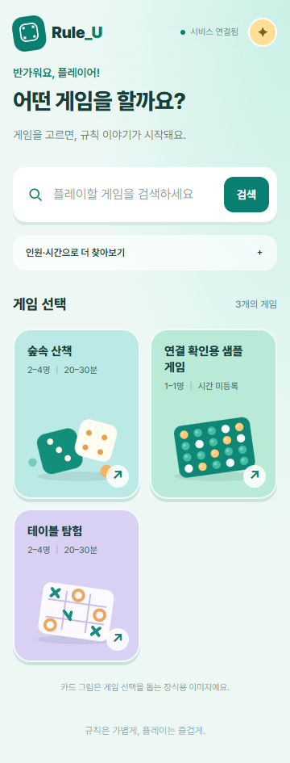
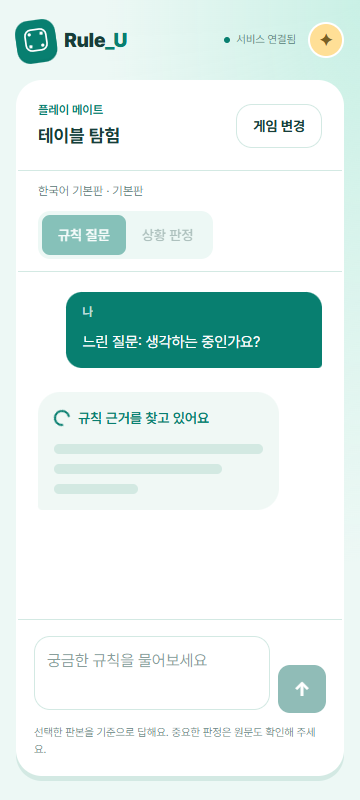

# 모바일 게임 UI 리디자인

2026-10-22 사용자 제공 레퍼런스를 반영했다. frontend-design 스킬을 적용했으며 새 라이브러리는 추가하지 않았다.

- 첫 화면: 민트 배경, 게임 검색창, 파스텔 카드형 게임 셀렉트. 모바일 2열·태블릿 3열·데스크톱 4열. 카드 그림은 공식 게임 표지가 아닌 장식용 SVG 보드게임 소품이다.
- 게임 선택: 카드 클릭 → 판본·호환 확장 모달 → 노란 대화 시작 버튼. 모달은 네이티브 dialog로 포커스 제한과 Escape 닫기를 지원한다.
- 채팅: 게임 선택 화면과 분리하고 말풍선·하단 입력창·게임 변경 버튼을 제공한다. 답변 대기 중 회전 스피너와 3줄 스켈레톤을 표시한다. 모션 감소 환경에서는 정적인 상태 표시로 전환한다.
- 복원: 새로고침 시에도 첫 화면은 게임 선택이며, 저장된 대화와 진행 요청은 ‘이전 대화 이어하기’로 재개한다. 대화 복원·인용·실패 재시도·세션 접근 검사는 유지한다.
- 검증: TypeScript·ESLint·Prettier·production build 통과. Playwright 모바일/데스크톱 16개 통과. 초기 화면 분리, 모달 포커스/Escape, 대기 스피너/스켈레톤 노출·완료 후 제거, 새로고침 후 게임 선택 복귀를 추가 검증했다. 360/768/1440px 가로 넘침을 검사하고 화면을 직접 확인했다. 백엔드와 실제 모델 설정은 변경하지 않았다.

## 화면

[데스크톱 게임 선택](mobile-game-ui/lobby-desktop.png)
